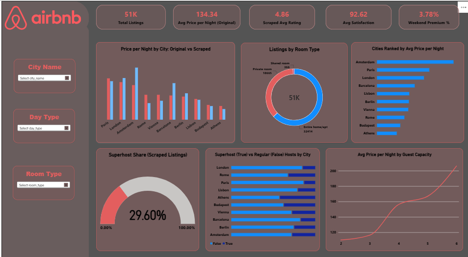

# Airbnb Prices in European Cities

End-to-end data engineering project: merge raw CSVs, scrape extra Airbnb features with Selenium, clean the data, model it in a star schema (SQL Server), and build a Power BI dashboard.

## Pipeline

1. **Connect dataset files** - merge the 20 Kaggle CSV files (10 European cities x weekday/weekend). City and day type exist only in the file names, so they are added as columns.
2. **Handle missing values / enrich** - Selenium scraping of extra features from Airbnb (price per night, rating, number of reviews, Superhost, Guest Favorite) for Entire home/apt listings with 2+ bedrooms, up to 50 listings per city.
3. **Save cleaned data** - nulls, duplicates and extreme price outliers handled; saved as CSV and Excel.
4. **SQL normalization (star schema)** - `Dim_City`, `Dim_DayType`, `Dim_RoomType`, `Dim_Host` and two fact tables: `Fact_Listing_Price` (original data) and `Fact_Scraped_Listing` (scraped data). `Dim_City` is shared by both facts (galaxy schema).
5. **Power BI dashboard** - relationships, DAX measures, KPIs, slicers and visuals.

## Repository structure

| File | Purpose |
|---|---|
| `Airbnb_Project.ipynb` | Merge, scraping, cleaning, quick checks, load to SQL Server |
| `04_schema.sql` | Creates the `AirbnbDW` database and star schema |
| `06_powerbi_guide.md` | Model relationships and DAX measures |
| `requirements.txt` | Python dependencies |
| `dashboard/` | Power BI file and screenshot |

## How to run

1. Download the dataset from Kaggle: *Airbnb Prices in European Cities* and put the CSV files in a folder (set `RAW_DIR` in the notebook config).
2. `pip install -r requirements.txt`
3. Open `Airbnb_Project.ipynb` and run all cells. `RUN_SCRAPE` and `RUN_SQL` are `False` by default.
4. To scrape: set `RUN_SCRAPE = True` (needs Chrome, takes about an hour for 50 listings per city). Scrape only where the site terms allow it.
5. Run `04_schema.sql` in SQL Server Management Studio, set your server name in the connection string, then set `RUN_SQL = True` to load the data.
6. Open the Power BI file and refresh, or rebuild it with `06_powerbi_guide.md`.

## Data notes and limitations

- Original price (`realSum`) is the total for two nights; scraped price is per night. The dashboard compares them per night (original / 2).
- The two datasets have no shared listing key, so they are compared only at city level through `Dim_City`.
- The comparison uses Entire home/apt with 2 bedrooms in the original data to match the scraped listings.
- Airbnb search can include listings "near" a city, not strictly inside it.
- Scraped ratings of 5.0 mostly come from listings with very few reviews.
- Scraped prices depend on the dates used in the search (a fixed Monday-Wednesday stay a few weeks ahead, in EUR).

## Tech stack

Python (pandas, Selenium, SQLAlchemy), Jupyter, SQL Server, Power BI (DAX).
